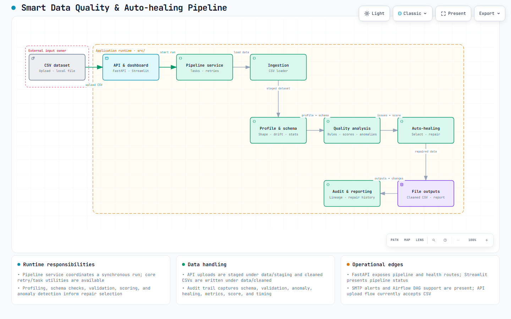
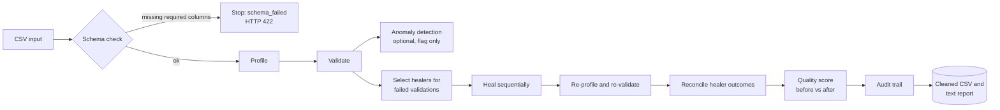

# Smart Data Quality & Auto-Healing Pipeline

> Upload a messy CSV and get back a scored, validated, **automatically repaired** dataset, with a full audit trail of every change.


The **Adaptive Data Quality Platform** is a pipeline driven by YAML configuration. It checks a tabular dataset against a schema, profiles it, runs pluggable validators, and repairs what it can with matching healers. It then re-validates the result and reports a weighted **data quality score** before and after healing.

You can run it three ways: a one-shot **CLI**, a **FastAPI** service, or an interactive **Streamlit dashboard** that sits on top of the API.

---

## Table of contents

- [Highlights](#highlights)
- [Architecture](#architecture)
- [How the pipeline works](#how-the-pipeline-works)
- [Example run](#example-run)
- [Quick start](#quick-start)
- [Usage](#usage)
  - [CLI](#1-cli)
  - [REST API](#2-rest-api)
  - [Streamlit dashboard](#3-streamlit-dashboard)
- [Configuration](#configuration)
- [Quality score](#quality-score)
- [Extending the pipeline](#extending-the-pipeline)
- [Project structure](#project-structure)
- [Testing](#testing)
- [Limitations and roadmap](#limitations-and-roadmap)
- [License](#license)

---

## Highlights

- **Schema contract checks**: required columns, extra columns, expected dtypes, and nullability. A dataset that is missing required columns is rejected before any other stage runs.
- **Dataset profiling**: row and column counts, missing values per column, duplicate rows, dtypes, memory usage, and numeric and categorical summaries.
- **Pluggable validators**: null, duplicate (optionally on a key subset), datatype, and regex checks. Built-in aliases cover `EMAIL`, `PHONE`, `URL` and `PINCODE`.
- **Targeted auto-healing**: only the healers that match a *failed* validation run, so clean data is left alone.
  - Missing values: `mean`, `median`, `mode` or `constant`
  - Duplicate removal
  - Safe type conversion that keeps unconvertible values instead of dropping them
  - Text normalisation: trim whitespace, lowercase emails, strip phone symbols
- **Truthful outcomes**: after healing, each healer's status (`success` / `partial` / `failed`) is reconciled against the final validation results, so the reported repair counts match what actually changed.
- **Weighted quality score** (0–100) built from completeness, validity and uniqueness, compared before and after healing.
- **Optional anomaly detection** with Isolation Forest on numeric, non-ID features. Anomalies are *flagged for review* and never auto-healed.
- **Audit trail** for every run: schema result, initial and final validation, anomalies, healing actions, metrics, score, and timing. The audit trail stores metadata only and never the data itself.
- **Outputs**: a cleaned CSV and a plain-text quality report, plus a JSON API response for each run.

---

## Architecture

<picture>
  <source media="(prefers-color-scheme: dark)" srcset="architechture-archify/architecture.visual-check.1440x900.dark.png">
  
</picture>

An interactive version of the diagram is in [`architechture-archify/architecture.html`](architechture-archify/architecture.html).

The design follows three principles:

1. **The backend is the source of truth.** All pipeline logic lives in `src/`. The Streamlit frontend only renders what the API returns and never re-implements any checks.
2. **Configuration decides the plugins.** `ValidatorFactory` and `HealerFactory` build plugin instances from the YAML files in `config/`. To turn a check or repair on or off, edit YAML; no code change is needed.
3. **Every stage returns a result object.** `SchemaResult`, `ProfileResult`, `ValidationResult`, `HealingResult`, `AnomalyResult` and `QualityScore` are all collected into a single `PipelineResult`. `PipelineResult` serialises to a JSON payload that is safe to return from the API.

---

## How the pipeline works



Each run goes through these stages, orchestrated by `src/core/pipeline.py`:

| # | Stage | What happens |
|---|-------|--------------|
| 1 | **Schema validation** | Compares the columns, dtypes and nullability against `schema` in `pipeline_config.yaml`. If required columns are missing, the run stops early and nothing else runs. |
| 2 | **Profiling** | `DatasetProfiler` produces a `ProfileResult` for the input data. |
| 3 | **Initial validation** | All enabled validators run, and each returns a pass or fail with the affected row indices. |
| 4 | **Anomaly detection** | When enabled, Isolation Forest scores the numeric feature columns. Columns with `id` in the name are excluded. |
| 5 | **Healer selection** | `HealerManager` maps failed validation types (`missing`, `duplicate`, `datatype`, `regex`) to the healers that fix them. |
| 6 | **Healing** | The selected healers run in order on a deep copy of the data: missing → duplicate → datatype → regex. A healer that raises an error is recorded as `failed`, and the run continues. |
| 7 | **Re-profiling and re-validation** | The same profiler and validators run again on the healed data. |
| 8 | **Reconciliation** | Each healer's status and its `repaired` / `remaining` counts are recalculated from the before and after validation results. |
| 9 | **Scoring and audit** | The quality score is calculated for both versions and compared. The metrics and audit trail are attached to the `PipelineResult`. |

---

## Example run

These are the results on the bundled sample `data/sample_data/employees.csv` (1,030 rows, 17 columns), using the default configuration:

| Check | Before | After | Healer outcome |
|-------|-------:|------:|----------------|
| Missing values | 332 | **0** | Missing Value Healer: `success` |
| Invalid `salary` values (datatype) | 29 | **0** | Datatype Healer: `success` |
| Regex failures (`email` + `phone`) | 734 | **195** | Regex Healer: `partial` |
| Rows in duplicate groups | 14 | **12** | Duplicate Healer: `partial` |
| Validators passing | 1 / 6 | **3 / 6** | |
| **Quality score** | **77.02** | **94.13** | **+17.12** |

The score is made up of these components:

| Component | Before | After |
|-----------|-------:|------:|
| Completeness | 98.10 | 100.00 |
| Validity | 27.28 | 81.62 |
| Uniqueness | 98.64 | 98.83 |

> The `partial` outcomes are deliberate. The regex healer only normalises formatting, so it cannot invent a valid email address. Normalising values can also make two rows identical after the duplicate stage has already run. The pipeline reports these leftovers instead of hiding them.

---

## Quick start

**Requirements:** Python 3.10 or later. Python 3.11 is recommended and matches the Docker base image.

<details open>
<summary><strong>macOS / Linux</strong></summary>

```bash
git clone https://github.com/akshat-tumkur/smart-data-quality-auto-healing-pipeline.git
cd smart-data-quality-auto-healing-pipeline

python3.11 -m venv .venv
source .venv/bin/activate
python -m pip install --upgrade pip
python -m pip install -r requirements.txt
```
</details>

<details>
<summary><strong>Windows (PowerShell)</strong></summary>

```powershell
git clone https://github.com/akshat-tumkur/smart-data-quality-auto-healing-pipeline.git
cd smart-data-quality-auto-healing-pipeline

py -3.11 -m venv .venv
.\.venv\Scripts\Activate.ps1
python -m pip install --upgrade pip
python -m pip install -r requirements.txt
```
</details>

To check the installation, run the pipeline on the sample dataset:

```bash
python main.py
```

---

## Usage

### 1. CLI

`main.py` runs the pipeline on the dataset set in `dataset.path` in `config/pipeline_config.yaml`:

```text
$ python main.py
========================================
SMART DATA QUALITY PIPELINE COMPLETED
========================================

Rows Processed : 1030
Validators Run : 6
Validators OK  : 3
Validators Fail: 3
Healers Run    : 4

Cleaned Dataset:
data/cleaned/employees_cleaned.csv

Report:
reports/report_YYYYMMDD_HHMMSS.txt
```

The text report has sections for schema validation, the initial and final dataset profiles, each validator's result, an auto-healing summary, before and after improvements, the quality score, anomalies, and an audit summary.

### 2. REST API

Start the API from the repository root:

```bash
python -m uvicorn api.app:app --app-dir src --reload --host 127.0.0.1 --port 8000
```

Interactive OpenAPI docs are at <http://127.0.0.1:8000/docs>.

| Method | Endpoint | Description |
|--------|----------|-------------|
| `GET`  | `/health` | Returns `{"status": "ok"}` when the service is running. |
| `POST` | `/pipeline/run` | Runs the pipeline on a CSV sent as multipart form data in the field `file`. |
| `GET`  | `/pipeline/{run_id}/download` | Downloads the cleaned CSV that the given run produced. |

**Run the pipeline:**

```bash
curl -F "file=@data/sample_data/employees.csv" http://127.0.0.1:8000/pipeline/run
```

**Download the cleaned dataset:**

```bash
curl -OJ http://127.0.0.1:8000/pipeline/<run_id>/download
```

**Response shape** (`200 OK`):

```jsonc
{
  "status": "success",            // or "schema_failed"
  "run_id": "ab949ff6…",          // 32-character hex string, used for the download URL
  "schema": { … },                // SchemaResult
  "initial_profile": { … },       // ProfileResult before healing
  "initial_validation": [ … ],    // ValidationResult list before healing
  "anomaly_detection": null,      // AnomalyResult, or null when detection is disabled
  "healing": [ … ],               // HealingResult list, reconciled
  "final_profile": { … },
  "final_validation": [ … ],
  "quality_score": { "enabled": true, "initial": { … }, "final": { … }, "delta": 17.1166 },
  "metrics": { "missing_values": { "before": 332, "after": 0, "delta": -332 }, … },
  "audit_trail": { … },
  "execution_time": 0.19,
  "output": { "cleaned_dataset": "…", "report": "…" }
}
```

**Errors:**

| Status | When |
|--------|------|
| `400` | The upload is empty or is not a valid CSV. |
| `404` | No cleaned dataset exists for the requested `run_id`. |
| `415` | The uploaded file does not have a `.csv` extension. |
| `422` | Required schema columns are missing. `detail.result` still contains the structured schema result. |
| `500` | The pipeline failed unexpectedly. Server internals are not exposed in the response. |

### 3. Streamlit dashboard

With the API running, open a second terminal, activate the same virtual environment, and run:

```bash
export API_BASE_URL=http://127.0.0.1:8000     # PowerShell: $env:API_BASE_URL = "http://127.0.0.1:8000"
streamlit run frontend/app.py
```

The dashboard has these features:

- API connection status and a CSV upload area
- Quality score before and after healing, with charts for each component
- "Issues before vs after", issue reduction, and healing effectiveness charts
- A "What needs attention?" panel that ranks the remaining issues
- Detailed views for the schema, validation, healing, anomalies, and audit timeline
- A **Download cleaned CSV** link for the current run

`API_BASE_URL` defaults to `http://localhost:8000`. The download link points directly at the API, so the API address must be reachable from your **browser** as well as from the Streamlit server.

---

## Configuration

The pipeline reads three YAML files from `config/`. `config/config_loader.py` loads them, fills in defaults, and validates them.

### `pipeline_config.yaml`: dataset, schema, anomaly detection and scoring

```yaml
dataset:
  path: data/sample_data/employees.csv   # input file for the CLI (the API uses the uploaded file instead)
  delimiter: ","
  encoding: utf-8
  has_header: true

schema:
  allow_extra_columns: true              # if false, any column not listed here fails the schema check
  columns:
    employee_id: { type: string,  nullable: false }
    salary:      { type: numeric, nullable: false }
    age:         { type: int,     nullable: false }
    # …

anomaly_detection:
  enabled: false                         # set to true to flag outliers with Isolation Forest
  method: isolation_forest
  contamination: 0.05                    # must be greater than 0 and at most 0.5
  random_state: 42

quality_score:
  enabled: true
  weights: { completeness: 0.40, validity: 0.30, uniqueness: 0.30 }
```

Supported schema types are `int`/`integer`, `float`, `numeric`/`number`, `string`/`str`, and `datetime`/`timestamp`.

### `validation_rules.yaml`: which checks run

```yaml
validation:
  "null":      { enabled: true }
  duplicate:   { enabled: true }          # optional: subset: [email]
  datatype:
    enabled: true
    columns: { salary: float, performance_rating: int }   # int | float | numeric | datetime | string
  regex:
    - { column: email, pattern: EMAIL }   # alias, or any raw regex
    - { column: phone, pattern: PHONE }
```

The regex aliases are defined in `src/utils/regex_aliases.py`: `EMAIL`, `PHONE`, `URL` and `PINCODE`. Any other value is used as a raw regular expression.

### `healing_rules.yaml`: how failures are repaired

```yaml
healing:
  missing:
    enabled: true
    strategy: median          # mean | median | mode | constant (constant requires fill_value)
    # columns: [salary, age]  # optional; defaults to all columns
  duplicate:
    enabled: true             # keeps the first occurrence; optional subset
  datatype:
    enabled: true             # uses the column types from validation.datatype unless columns is set here
  regex:
    enabled: true
    lowercase_email: true     # applies to columns whose name contains "email"
    trim_whitespace: true
    remove_phone_symbols: true  # applies to columns whose name contains "phone", "mobile" or "tel"
```

For non-numeric columns, the `mean` and `median` strategies fall back to `mode`. The datatype healer does not drop values: any value it cannot convert is left unchanged and reported in the healer's metadata.

---

## Quality score

`QualityScoreCalculator` (`src/quality/quality_score.py`) calculates three components, each on a 0–100 scale:

| Component | Formula |
|-----------|---------|
| **Completeness** | non-null cells ÷ total cells |
| **Validity** | rows not flagged by any failed validator ÷ total rows (a row flagged by several validators counts once) |
| **Uniqueness** | rows not in a duplicate group ÷ total rows (uses the duplicate validator's key subset when one is configured) |

The overall score is the weighted average of the three components. Weights are normalised to sum to 1, and invalid or zero weights fall back to the defaults of 0.4, 0.3 and 0.3. The score is calculated for the data before and after healing, and the API returns both values along with the `delta`.

---

## Extending the pipeline

### Add a validator

1. Subclass `BaseValidator` in `src/validation/validators/`. Set a `validation_type` and return a `ValidationResult`. If you put `invalid_indices` in its metadata, validity scoring will use it.
2. Add it to `ValidatorFactory` (`src/validation/validator_factory.py`), and read its options from `validation_rules.yaml`.

```python
class RangeValidator(BaseValidator):
    validation_type = "range"

    def __init__(self, column, minimum, maximum):
        super().__init__("Range Validator")
        self.column, self.minimum, self.maximum = column, minimum, maximum

    def validate(self, df):
        bad = ~df[self.column].between(self.minimum, self.maximum)
        return ValidationResult(
            validator_name=self.validator_name,
            status=not bad.any(),
            message=f"{int(bad.sum())} values out of range in '{self.column}'.",
            rows_affected=int(bad.sum()),
            execution_time=0.0,
            metadata={"invalid_indices": df[bad].index.tolist()},
        )
```

### Add a healer

1. Subclass `BaseHealer` in `src/auto_healing/healers/`. Set `display_name` and `validation_types`, which are the failed validation types that should trigger this healer. Implement `heal(df) -> (df, HealingResult)`.
2. Add it to `HealerFactory` (`src/auto_healing/healer_factory.py`), and read its options from `healing_rules.yaml`.

`HealerManager` will select the new healer automatically whenever a validation with a matching type fails.

---

## Project structure

```text
.
├── main.py                     # CLI entry point
├── config/                     # YAML configuration and config_loader.py
├── data/
│   ├── sample_data/            # employees.csv sample dataset
│   ├── staging/                # API uploads (one file per run_id)
│   └── cleaned/                # cleaned CSV outputs
├── reports/                    # timestamped text reports
├── src/
│   ├── api/                    # FastAPI app, routes and PipelineService
│   ├── core/                   # Pipeline orchestrator and PipelineResult
│   ├── ingestion/              # CSV loader and ingestion manager
│   ├── schema/                 # schema validation contract
│   ├── profiling/              # DatasetProfiler and ProfileResult
│   ├── validation/             # validator base class, factory, manager and plugins
│   ├── auto_healing/           # healer base class, factory, manager and plugins
│   ├── anomaly_detection/      # detector contract and Isolation Forest
│   ├── quality/                # weighted quality score
│   ├── audit/                  # audit trail builder
│   ├── reporting/              # text report generator
│   └── utils/regex_aliases.py  # EMAIL / PHONE / URL / PINCODE patterns
├── frontend/
│   ├── app.py                  # Streamlit dashboard
│   ├── result_views.py         # result rendering and insights
│   └── services/api_client.py  # HTTP client for the API
├── tests/unit/                 # pytest suite
├── architechture-archify/      # architecture diagram (HTML and PNG)
├── Dockerfile
└── docker-compose.yml
```

> Several modules are **scaffolding placeholders** that contain only a docstring. These include `src/alerts/`, `src/ml/`, `src/storage/`, `src/dashboard/`, `src/quality_score/`, `src/core/airflow_dag.py`, the Postgres and API loaders, and the IQR, Z-score, LOF and One-Class SVM detectors. They mark planned extensions; see the [roadmap](#limitations-and-roadmap).

---

## Testing

```bash
python -m pytest -q
```

The suite has 61 tests. It covers schema validation, profiling, config-driven factories, healer selection and reconciliation, the quality score, anomaly detection, the API routes (health, run, download, and error codes), the frontend API client, and the dashboard rendering through Streamlit `AppTest`. `pyproject.toml` already puts `src/` on `pythonpath`, so you do not need to install the package first.

---

## Limitations and roadmap

**Current limitations**

- Only CSV input is supported, and each upload is processed synchronously in a single request.
- One schema, set in `pipeline_config.yaml`, applies to every upload. A CSV without the configured columns returns HTTP 422.
- The only anomaly detection method is Isolation Forest, and its results are informational only.
- Staged uploads, cleaned outputs and reports build up on disk with no retention policy. Reports are written to `reports/` relative to the current working directory.
- `config/database.yaml`, `config/ml_config.yaml`, `config/logging.yaml`, and the `pipeline.batch_size` and `pipeline.retry_count` settings are not read yet.
- The `Dockerfile` and `docker-compose.yml` are placeholders. They install the dependencies but do not start the API or the dashboard yet.
- The FastAPI app has no CORS middleware. The dashboard does not need it, because it calls the API from the Streamlit server.

**Planned (scaffolded) work**

- [ ] Postgres and REST API ingestion, plus Parquet and Postgres storage writers
- [ ] More anomaly detectors: IQR, Z-score, Local Outlier Factor, One-Class SVM
- [ ] Business-rule, consistency and accuracy validators
- [ ] Email and notification alerts when the quality score drops below a threshold
- [ ] Airflow DAG, retry manager and task runner for scheduled batch runs
- [ ] ML model training and evaluation for learned repairs
- [ ] A Docker image that serves the API and dashboard, and CI under `deployment/github_actions/`

---

## License

Released under the [MIT License](LICENSE).
